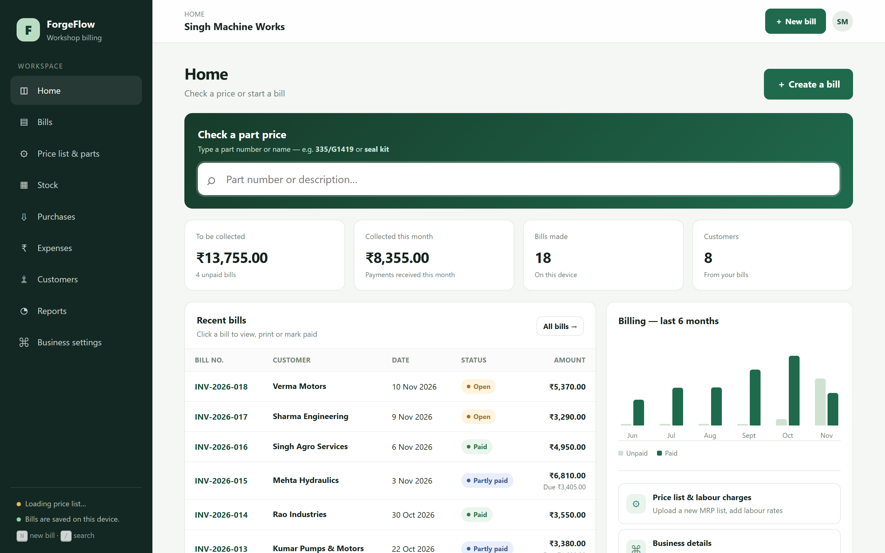
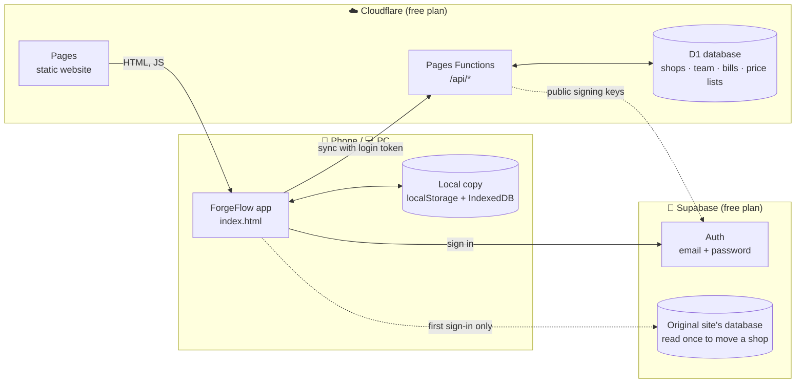
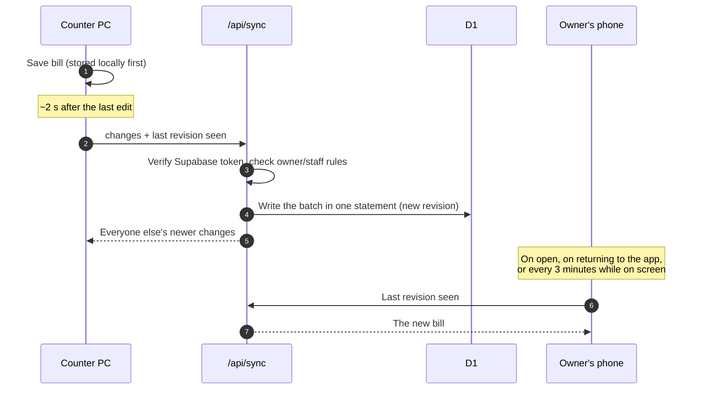

<div align="center">


# ForgeFlow — Workshop Billing

### Fast GST billing for machine-parts workshops, running on Cloudflare's edge.

Type a part number, press <kbd>Enter</kbd>, and the MRP and GST fill in from your own price list.<br>
Bills, stock, purchases, expenses, GST reports and staff logins — on every phone and computer in the shop.

<br>

[](https://digvijayy.pages.dev/)

<br>

[](https://pages.cloudflare.com/)
[](https://developers.cloudflare.com/d1/)
[](https://supabase.com/auth)
[](#-tech-stack)
[](#-tech-stack)
[](test/api.test.mjs)
[](#-free-plan-capacity)

<br>

[**Live app**](https://digvijayy.pages.dev/) · [**Deploy your own**](SETUP.md) · [**Report a bug**](https://github.com/digvijay165/digvijayy/issues) · [**Original edition**](https://github.com/digvijay165/ForgeFlow-Workshop-Billing)

<br>

<a href="https://digvijayy.pages.dev/"></a>

</div>

<br>

## ✨ Highlights

<table>
<tr>
<td width="33%" valign="top">

### ⚡ Billing in seconds
Search 60,000+ parts by number or name, press <kbd>Enter</kbd> to add them. MRP and GST fill in by themselves; repeat parts bump the quantity.

</td>
<td width="33%" valign="top">

### 🧾 Proper GST invoices
GST-inclusive MRP, CGST / SGST / IGST split, round-off, amount in words, UPI QR for the balance, print or PDF.

</td>
<td width="33%" valign="top">

### 👷 Owner + staff
Staff make bills and take payments. Only the owner can delete, see reports and expenses, or change settings.

</td>
</tr>
<tr>
<td valign="top">

### 📴 Works offline
Everything is saved on the device first and synced when the internet is back. Installable on a phone like an app.

</td>
<td valign="top">

### 📊 Excel everywhere
Upload MRP lists from `.xlsx`, back up to Excel, and auto-save every bill to an Excel file (or a OneDrive link).

</td>
<td valign="top">

### 💸 Free to run
Cloudflare Pages + D1 and Supabase Auth on free plans — no server to manage, no card needed.

</td>
</tr>
</table>

<details>
<summary><b>See every feature</b></summary>

<br>

| Area | What you get |
| --- | --- |
| **Billing** | Instant part lookup across several price lists · type-and-Enter lines · labour and discounts · customer memory · estimates that convert to bills · part payments with balance due · copy a bill |
| **GST** | MRP treated as tax-inclusive · CGST/SGST or IGST · GST breakup by rate · round-off and amount in words · print / Save as PDF |
| **Stock & money** | Stock falls with bills and rises with purchases · low-stock alerts · stock counts · supplier purchases with input GST · expenses by category |
| **Reports** *(owner)* | GST summary · GSTR-1 helpers (B2B list, B2C by rate) · day-by-day sales and collections · rough profit |
| **Team** | Email/password login · owner invites staff by email · staff limited to bills, stock, purchases and saved items |
| **Sharing & data** | WhatsApp and email summaries · CSV export · Excel backup and restore · auto-save to an Excel file or a OneDrive link |

</details>

<br>

## 🏗️ Architecture

The website is static files on Cloudflare Pages. A small API on **Pages Functions** checks the Supabase login token and reads and writes **D1** (SQLite). Each device keeps a full local copy, so the app opens instantly and keeps working offline.



### How a bill syncs



One request both sends and receives, and devices only sync while the app is on screen — that is what keeps a busy shop well inside Cloudflare's free daily limit.

<br>

## 📈 Free plan capacity

| Resource | Free allowance | What it means for a workshop |
| --- | --- | --- |
| API requests | 100,000 / day | ~2 per app open + 1 every 3 min on screen → **roughly 400–500 devices used all day** |
| D1 storage | 500 MB per database, 5 GB per account | Bills are ~1–2 KB; a 65,000-part MRP list is **~0.9 MB** zipped |
| Website traffic | Unlimited | Static files don't count as requests |
| Logins | 50,000 monthly users | Supabase Auth free plan |

If the daily request limit is ever reached, the app keeps working offline and syncs again after midnight UTC (5:30 AM IST).

<br>

## 🛠️ Tech stack

| Layer | Built with |
| --- | --- |
| App | HTML5, CSS3, vanilla JavaScript — one page, no framework, no build step |
| On the device | `localStorage` for bills, IndexedDB for price lists, a service worker for offline use |
| Excel | Native `.xlsx` reader and writer using `DecompressionStream` / a hand-written zip — no libraries |
| API | Cloudflare Pages Functions (`functions/api/[[path]].js`), Supabase JWT verified with WebCrypto against the project's JWKS |
| Database | Cloudflare D1 (SQLite): per-shop revision counter for sync, gzip-compressed price-list chunks |
| Login | Supabase Auth (email + password, password reset) |
| Tests | Node's built-in test runner against a local D1 (`wrangler pages dev`) |

<br>

## 📁 Project structure

```
digvijayy/
├── public/                     # The website (deployed as-is)
│   ├── index.html              # The whole app: UI, styles and logic
│   ├── js/cloud.js             # Login, roles, sync, price-list upload, moving a shop
│   ├── config.js               # Supabase login keys and API address
│   ├── sw.js · manifest.json   # Offline support and phone install
│   └── icon.svg
├── functions/api/[[path]].js   # The API (Cloudflare Pages Functions)
├── schema.sql                  # D1 tables
├── wrangler.toml               # Cloudflare project + D1 binding
├── test/api.test.mjs           # End-to-end API tests
└── SETUP.md                    # Deploy your own copy
```

<br>

## 🚀 Getting started

**Just use it:** open **[digvijayy.pages.dev](https://digvijayy.pages.dev/)** and create an account. Shop owners from the [original edition](https://github.com/digvijay165/ForgeFlow-Workshop-Billing) simply sign in — their shop, team, bills and price lists move over automatically the first time.

**Run it locally**

```bash
git clone https://github.com/digvijay165/digvijayy.git
cd digvijayy
npm install
npm run db:local      # create the tables in a local D1
npm run dev           # http://localhost:8788
```

**Run the tests**

```bash
npm test
```

They start the API against a throwaway local database with a test signing key — nothing touches Cloudflare or Supabase.

**Deploy your own** — about 10 minutes, free, no card: see **[SETUP.md](SETUP.md)**. After that, publishing is one command:

```bash
npm run deploy
```

<br>

## 🔒 Security & privacy

- Every API request carries the Supabase login token; the API checks its signature, expiry and project before touching any data.
- A shop's bills and price lists are only readable by members of that shop. Staff cannot delete records or touch settings and expenses — enforced on the server, not just hidden in the app.
- Price lists are read in your browser and stored per shop; other shops can never see them.
- **Business settings → Download backup** gives you a full Excel copy of everything at any time.

<br>

## 🗺️ Roadmap

- [x] Cloud sync across devices and staff accounts
- [x] Stock, purchases, expenses and GST reports
- [x] Excel backup, restore and auto-save
- [x] Cloudflare Pages + D1 backend
- [ ] One-time invite codes for staff
- [ ] HSN codes on bills
- [ ] Send the bill PDF straight to WhatsApp

<br>

## 👤 Author

**Digvijay Singh** · [@digvijay165](https://github.com/digvijay165) · [Portfolio](https://digvijay165.github.io/portfolio/)

<div align="center">

<br>

If ForgeFlow helps your workshop, consider giving it a ⭐

</div>
